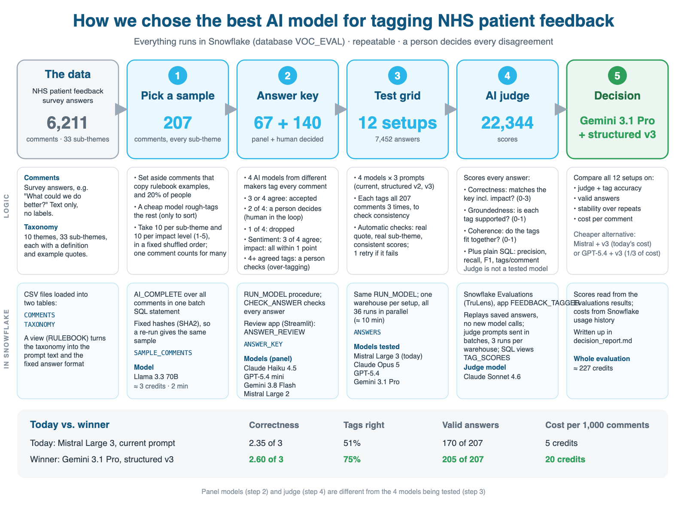

# NHS feedback tagging evaluation

**Goal:** find which AI model and prompt tags patient comments with the right sub-themes, sentiment and impact
most accurately, treating the data like real customer feedback (text only, no labels).

Everything runs in Snowflake: database `VOC_EVAL`, schema `HARNESS`, role `VOC_EVAL_ROLE`.

**Result (v3, current):** switch from today's setup (Mistral Large 3, current prompt) to **Gemini 3.1 Pro with the
structured v3 prompt (C09)**: top precision (0.75) and groundedness/coherence (0.85), the right number of tags (1.89
per comment vs the key's 1.69), valid for 205 of 207 comments and by far the most consistent (same tags in all 3 runs
for 83% of comments; today's setup 39%), at about 3.8x today's cost. **Quick win at today's cost:** keep Mistral and
switch only the prompt to v3 (C10: precision 0.51 -> 0.65, consistency 39% -> 58%). Cheaper option: GPT-5.4 with v3
(C11). Full details in `decision_report.md`. This run cost about 227 credits.

**Result of the previous run (v2):** switch from today's setup (Mistral Large 3, current prompt) to **Gemini 3.1 Pro with
the structured prompt (C08)**: joint best on correctness, best on tag quality, valid for all 209 comments, at about
3.9x today's cost per comment. Cheaper option: GPT-5.4 with the structured prompt (C07). That run cost about 162
credits; v3 confirms Gemini 3.1 Pro as the best model.

**Why v3 (a fresh, step-by-step rerun with tag-accuracy checks):** an aggregation trial showed that wrong
tags distort the reports built from them: today's setup gave about 3.1 sub-themes per comment where the answer key
has 1.7, so only about half of its tags were right (precision 48%, recall 88%). v3 therefore adds plain-SQL
**precision, recall, F1 and over-tagging** checks (`sql/tag_scores.sql`) at every step, alongside the AI judge.
The v2 Snowflake results were cleared for the fresh start; its numbers stay in this README.

## The approach at a glance

---

## Where we are

**v3 (current run):**

| Step | Status |
|---|---|
| 0. Roll back the paused aggregation trial | Done: objects removed |
| 1. Fresh start | Done: result tables and Evaluations runs cleared; `COMMENTS`, `TAXONOMY` and setup kept |
| 2. Pick a test sample | Done: **207 comments** (every sub-theme 10+ except Parking 3; every impact level 17+) |
| 3. Panel + over-tagging check | Done: 4 models, 1.8-2.3 tags per comment, none over-tagging (see below) |
| 4. Answer key + human review (new: 4+ tag guard) | Done: 67 panel + 140 human = 207 rows, 1.69 tags per comment. Review app shows **10 comments per page** with one "Save this page" button |
| 5. Tag-accuracy scores (precision, recall, F1) | Done (`sql/tag_scores.sql`). Panel vs key: F1 0.75-0.81 (partly circular: the panel built the key) |
| 6. Grid (smoke test, then 8 setups x 3 repeats) | Done: 24 runs, 4,968 answers (see below) |
| 7. Over-tagging fix test (C09-C12: v3 prompt on all 4 models) | Done: the v3 rule helps every model (precision +0.03 to +0.14, consistency up); a confidence cut does not |
| 8. Judge (12 setups x 3 repeats = 36 runs) | Done: all 36 runs, 207 tag scores each; 12 of 7,452 correctness scores missing (left out of averages) |
| 9. Decision report | Done: `decision_report.md` (v3). Winner **C09 Gemini 3.1 Pro + structured_v3** |
| 10a. Fresh-comment check (no key) | Done: the result holds on 100 new comments: C09 1.60 tags per comment (C01 2.49), groundedness 0.90 (C01 0.68), 100% valid (see step 10) |
| 10b. Answer-key audit (blind) | Ready: 30 items in the review app ("Blind audit"); waiting for the person's review |

**Step 3 panel profile** (`TAG_PROFILE`, no answer key needed, checked before voting):

| Panel | Model | Passed the checks | Tags per comment | 1 tag | 4+ tags |
|---|---|---|---|---|---|
| P01 | Claude Haiku 4.5 | 124 / 207 | 1.94 | 45% | 10% |
| P02 | GPT-5.4 mini | 179 / 207 | 2.26 | 32% | 16% |
| P03 | Gemini 3.8 Flash | 198 / 207 | 2.08 | 38% | 12% |
| P04 | Mistral Large 2 | 185 / 207 | 1.81 | 47% | 5% |

All under the 2.5 warning level, so all 4 vote. GPT-5.4 mini tags the most; because a tag needs 3 of 4 models, its
extra tags cannot enter the key on their own. Haiku fails mostly on sentiment scores not matching the label; the key
uses only its tags, labels and impact.

**Step 4 answer key:** 67 rows settled by the panel (1.43 tags per comment) + 140 by a person (1.81) = 207 rows,
**1.69 tags per comment**. The reviewer added tags on 26 comments (mostly 2-of-4 suggestions) and removed tags on 1,
so the key leans towards finding every point rather than being strict.

**Step 5 panel vs the key** (partly circular: the panel's votes helped build the key, so this is a sanity check):

| Panel | Model | Precision | Recall | F1 | Tags per comment | Exact match |
|---|---|---|---|---|---|---|
| P01 | Claude Haiku 4.5 | 0.76 | 0.87 | 0.81 | 1.94 | 54% |
| P02 | GPT-5.4 mini | 0.69 | 0.92 | 0.79 | 2.26 | 47% |
| P03 | Gemini 3.8 Flash | 0.73 | 0.90 | 0.80 | 2.08 | 52% |
| P04 | Mistral Large 2 | 0.72 | 0.77 | 0.75 | 1.81 | 47% |

**Step 6 grid, repeat 1** (`TAG_SCORES` vs the answer key; key = 1.69 tags per comment):

| Setup | Valid (of 207) | Precision | Recall | F1 | Tags per comment | Over-tagged comments | Exact match |
|---|---|---|---|---|---|---|---|
| C04 Gemini / current | 187 | 0.75 | 0.86 | **0.80** | 1.94 | 28% | 56% |
| C08 Gemini / structured | **206** | 0.73 | 0.84 | 0.78 | 1.96 | 29% | 53% |
| C06 Opus / structured | 206 | 0.61 | 0.89 | 0.73 | 2.45 | 50% | 37% |
| C07 GPT-5.4 / structured | 194 | 0.62 | 0.85 | 0.72 | 2.31 | 45% | 37% |
| C02 Opus / current | 171 | 0.60 | 0.91 | 0.72 | 2.55 | 56% | 36% |
| C03 GPT-5.4 / current | 188 | 0.61 | 0.89 | 0.72 | 2.49 | 51% | 39% |
| C05 Mistral / structured | 182 | 0.58 | 0.88 | 0.70 | 2.55 | 58% | 32% |
| C01 Mistral / current (today) | 172 | 0.51 | 0.88 | 0.64 | **2.93** | **72%** | 21% |

Every setup finds most of the right tags (recall 0.84-0.91); they differ in how many wrong extra tags they add.
Today's setup over-tags 72% of comments; its most over-used sub-themes are Continuity of care, Staff listening and
Competence & training (precision 0.24-0.40). Gemini 3.1 Pro is the only model close to the key's tag count.

**Step 6 grid, all 3 repeats** (averages; F1 range across repeats; "same in 3 repeats" = share of comments with the
identical answer in all 3 runs):

| Setup | Valid (of 207) | Precision | Recall | F1 (range) | Tags per comment | Over-tagged | Same tags in 3 repeats | Same impact in 3 repeats |
|---|---|---|---|---|---|---|---|---|
| C04 Gemini / current | 188 | 0.75 | 0.86 | **0.80** (0.80-0.80) | 1.94 | 29% | 72% | 93% |
| C08 Gemini / structured | **206** | 0.72 | 0.85 | 0.78 (0.78-0.79) | 1.98 | 30% | 69% | 88% |
| C06 Opus / structured | 205 | 0.61 | 0.90 | 0.73 (0.72-0.73) | 2.46 | 51% | **73%** | **94%** |
| C03 GPT-5.4 / current | 183 | 0.61 | 0.90 | 0.72 (0.72-0.73) | 2.48 | 52% | 61% | 86% |
| C02 Opus / current | 173 | 0.60 | 0.90 | 0.72 (0.72-0.72) | 2.52 | 54% | 69% | 93% |
| C07 GPT-5.4 / structured | 194 | 0.63 | 0.85 | 0.72 (0.72-0.72) | 2.29 | 43% | 63% | 88% |
| C05 Mistral / structured | 179 | 0.58 | 0.88 | 0.70 (0.70-0.71) | 2.56 | 57% | 45% | 85% |
| C01 Mistral / current (today) | 170 | 0.51 | 0.89 | 0.65 (0.64-0.65) | 2.92 | 73% | **39%** | 83% |

F1 moves by at most 0.01 between repeats, so the gaps between setups are real. Today's setup gives the same tags in
all 3 repeats for only 39% of comments.

**Step 7: over-tagging fix.** Two ideas tested:

1. *Drop low-confidence tags* (free, SQL only): does not work. The models are confident even about wrong tags; today's
   setup rates almost every tag 0.8 or higher, so a 0.7 cut removes nothing. Only a 0.9 cut removes tags, and then
   correct tags go too (C08: precision 0.72 -> 0.80 but recall 0.85 -> 0.72, F1 0.78 -> 0.76).
2. *Tell the model not to over-tag* (new setup **C09** = Gemini 3.1 Pro + `prompts/structured_v3.txt`, which is
   `structured_v2` plus one rule: "tag a sub-theme only when the comment makes a clear point about it; most comments
   make 1-2 points", with an example, and a matching final check). One variable changed against C08. Result
   (3 repeats each):

   | Setup | Valid (of 207) | Precision | Recall | F1 (range) | Tags per comment | Over-tagged | Same tags in 3 repeats |
   |---|---|---|---|---|---|---|---|
   | C04 Gemini / current | 188 | 0.75 | 0.86 | 0.80 (0.80-0.80) | 1.94 | 29% | 72% |
   | C08 Gemini / structured_v2 | 206 | 0.72 | 0.85 | 0.78 (0.78-0.79) | 1.98 | 30% | 69% |
   | **C09 Gemini / structured_v3** | 205 | **0.75** | 0.84 | **0.79** (0.79-0.79) | **1.89** | **25%** | **83%** |

   The rule helps: against C08, precision +0.03, over-tagged comments 30% -> 25%, for a small recall cost
   (0.85 -> 0.84, under-tagged 6% -> 9%). F1 rises 0.78 -> 0.79 and the same tags in all 3 repeats rise 69% -> 83%,
   the most consistent setup so far. C09 matches C04's precision while keeping C08's validity (205 vs 188).

3. *The same v3 rule on the other 3 models* (C10 Mistral, C11 GPT-5.4, C12 Opus), to check the fix comes from the
   prompt and not from Gemini. Per model, current -> structured_v2 -> structured_v3 (3 repeats each):

   | Model | Prompt | Setup | Valid (of 207) | Precision | Recall | F1 | Tags per comment | Over-tagged | Same tags in 3 repeats |
   |---|---|---|---|---|---|---|---|---|---|
   | Mistral Large 3 | current | C01 (today) | 170 | 0.51 | 0.89 | 0.65 | 2.92 | 73% | 39% |
   | Mistral Large 3 | structured_v2 | C05 | 179 | 0.58 | 0.88 | 0.70 | 2.56 | 57% | 45% |
   | Mistral Large 3 | structured_v3 | **C10** | 185 | **0.65** | 0.85 | **0.74** | **2.21** | **43%** | **58%** |
   | GPT-5.4 | current | C03 | 183 | 0.61 | 0.90 | 0.72 | 2.48 | 52% | 61% |
   | GPT-5.4 | structured_v2 | C07 | 194 | 0.63 | 0.85 | 0.72 | 2.29 | 43% | 63% |
   | GPT-5.4 | structured_v3 | **C11** | 195 | **0.67** | 0.84 | **0.74** | **2.13** | **37%** | **68%** |
   | Claude Opus 5 | current | C02 | 173 | 0.60 | 0.90 | 0.72 | 2.52 | 54% | 69% |
   | Claude Opus 5 | structured_v2 | C06 | 205 | 0.61 | 0.90 | 0.73 | 2.46 | 51% | 73% |
   | Claude Opus 5 | structured_v3 | **C12** | 203 | **0.66** | 0.87 | **0.75** | **2.23** | **42%** | **77%** |
   | Gemini 3.1 Pro | current | C04 | 188 | 0.75 | 0.86 | 0.80 | 1.94 | 29% | 72% |
   | Gemini 3.1 Pro | structured_v2 | C08 | 206 | 0.72 | 0.85 | 0.78 | 1.98 | 30% | 69% |
   | Gemini 3.1 Pro | structured_v3 | **C09** | 205 | 0.75 | 0.84 | 0.79 | **1.89** | **25%** | **83%** |

   The rule works on every model: v3 gives each model its best precision, fewest tags, least over-tagging and
   highest consistency, for a recall cost of 0.01-0.03. It helps weaker models most: today's model (Mistral Large 3)
   goes from 2.92 to 2.21 tags per comment, precision 0.51 -> 0.65, F1 0.65 -> 0.74 and consistency 39% -> 58% with
   no model change. Gemini 3.1 Pro stays best on every tag measure with any prompt.

**Step 8 judge** (Claude Sonnet 4.6 in Snowflake Evaluations; every score is saved in table `JUDGE_SCORES`; averages of 3 repeats; correctness
range in brackets). Ran in 2 waves with 3 judge runs per warehouse (a 20-comment test with 12 runs on one warehouse
lost 3 runs to upload collisions):

| Setup | Correctness (0-3) | Groundedness | Coherence | F1 (SQL) |
|---|---|---|---|---|
| C04 Gemini / current | **2.64** (2.63-2.64) | 0.83 | 0.84 | **0.80** |
| C08 Gemini / v2 | 2.63 (2.62-2.66) | 0.83 | 0.84 | 0.78 |
| **C09 Gemini / v3** | 2.60 (2.59-2.61) | **0.85** | **0.85** | 0.79 |
| C11 GPT-5.4 / v3 | 2.60 (2.58-2.62) | 0.78 | 0.78 | 0.74 |
| C07 GPT-5.4 / v2 | 2.59 (2.57-2.59) | 0.76 | 0.76 | 0.72 |
| C03 GPT-5.4 / current | 2.57 (2.56-2.58) | 0.72 | 0.72 | 0.72 |
| C06 Opus / v2 | 2.56 (2.52-2.59) | 0.76 | 0.75 | 0.73 |
| C12 Opus / v3 | 2.55 (2.53-2.57) | 0.78 | 0.78 | 0.75 |
| C02 Opus / current | 2.51 (2.47-2.55) | 0.75 | 0.73 | 0.72 |
| C10 Mistral / v3 | 2.50 (2.48-2.53) | 0.70 | 0.73 | 0.74 |
| C05 Mistral / v2 | 2.47 (2.46-2.49) | 0.68 | 0.69 | 0.70 |
| C01 Mistral / current (today) | 2.35 (2.33-2.38) | 0.63 | 0.60 | 0.65 |

The judge and the plain-SQL F1 agree: Gemini first, today's setup last, and v3 raises groundedness and coherence
for every model.

**v2 (previous run; its numbers are kept here for the record, `decision_report.md` now has v3):**

| Step | Status |
|---|---|
| 1. Load the raw data | Done |
| 2. Pick a test sample | Done (209 comments) |
| 3. Build the answer key | Done: 72 settled by the panel, 137 by a person |
| 4. Human review of undecided answers | Done: all 137 reviewed |
| 5. Test grid (8 setups x 3 repeats) | Done: 5,016 answers |
| 6. Judge scores every answer | Done: 15,044 scores |
| 7. Results report | Done: `decision_report.md` |

**Impact rating (new in v2):** every answer also rates the whole comment's impact from 1 to 5:

| Impact | Meaning |
|---|---|
| 1 | No problem raised (praise, thanks or nothing to improve) |
| 2 | Minor inconvenience (parking, signs, food choice) |
| 3 | Clearly affected the experience, no harm (a long wait, poor communication) |
| 4 | Significant distress, a delay in care or a failure of service |
| 5 | Harm or a risk to safety (serious neglect, a fall, a safeguarding concern) |

The same definition is in both prompts (`prompts/current_v2.txt`, `prompts/structured_v2.txt`). The v1 prompts and the v1
results (no impact) are kept only as files; Snowflake holds the v2 run.

---

> **Steps 1-7 below describe the method as first run in v2** (209-comment sample, 72 + 137 answer key, 8 setups,
> winner C08). v3 repeated the same method with a 207-comment sample, a 67 + 140 key, 12 setups and the tag-accuracy
> checks; its numbers are in "Where we are" above and in `decision_report.md`. Step 10 is v3 only.

## Step 1: Load the raw data

Two tables, loaded from `data/`:

| Table | Rows | What it holds |
|---|---|---|
| `COMMENTS` | 6,211 | `COMMENT_ID, RESPONDENT_ID, TRUST, SERVICE, DATE_RAW, QUESTION, COMMENT_TEXT, PATIENT_RATING` |
| `TAXONOMY` | 33 | The rulebook: 10 themes, 33 sub-themes, each with a definition and example quotes |

No labels, groups or flags: just the text, as real customer data would arrive.

## Step 2: Pick a test sample (`sql/sample.sql`)

Result: **`SAMPLE_COMMENTS`, 209 comments, at least 10 for every sub-theme and at least 10 for every impact level**
(except Parking, which has only 3: the data barely has any).

How:
1. **Set some comments aside** (never tested):
   - comments that copy a rulebook example quote, because a model would already know the answer
   - 20% of people, kept for writing prompt examples later
   - one person's comments always stay together
2. **Rough-tag the rest with a cheap model** (Llama 3.3): "which sub-themes is this about, which words show it,
   and how serious is it (impact 1-5)?" A tag only counts if those words are really in the comment. These rough
   tags are used only to pick the sample, never as the answer. Cost: about 3 credits, 2 minutes.
3. **Pick comments until every group has 10.** A group is a sub-theme or an impact level. Each group takes
   comments in a fixed shuffled order (a hash of the comment id, so nobody chooses). One comment counts for every
   group it is in, which is why it is 209 comments, not 380.

   Rough impact in the sample: 84 at level 1, 25 at 2, 55 at 3, 28 at 4, 17 at 5. Without the impact groups,
   the sample had only about 8 serious (level 5) comments.

Columns: `COMMENT_ID, QUESTION, COMMENT_TEXT, PICKED_FOR` (the group it was picked for),
`SUB_THEMES` (every sub-theme it seems to be about), `IMPACT` (Llama's rough impact; for picking only).

Note: Llama's rough tags can vary slightly between runs even at temperature 0, so re-running `sample.sql` can pick
a few different comments.

## Step 3: Build the answer key (`sql/setup.sql`, `sql/answer_key.sql`)

The answer key says what the correct tags, sentiment and impact are for each sample comment.

1. **4 different AI models (the panel)** each tag all 209 comments with the same prompt and answer format:

   | Panel | Model | Passed the checks |
   |---|---|---|
   | P01 | Claude Haiku 4.5 | 129 / 209 |
   | P02 | GPT-5.4 mini | 183 / 209 |
   | P03 | Gemini 3.8 Flash | 200 / 209 |
   | P04 | Mistral Large 2 | 183 / 209 |

   Each answer is checked automatically: the quote must be in the comment, the theme and sub-theme must be a real
   pair, the sentiment score must match its label, and impact must be a whole number 1-5. A failed answer is asked
   once more. (Haiku fails mostly on sentiment scores that don't match the label; the key uses only its tags,
   labels and impact.)
2. **Votes are counted per tag:**
   - 3 or 4 models gave it (with average confidence 0.7 or more): **accepted**
   - 2 models gave it: **split**, a person decides
   - 1 model gave it: dropped
   - sentiment is accepted when 3 or more models agree
   - impact is accepted when 3 or more models gave one and all are within 1 point (e.g. 3, 3, 4, 4); the value is
     the middle rating. A wider spread (e.g. 2 and 5) goes to a person
3. **Result (`ANSWER_KEY`) straight after the panel:**
   - 72 comments `DECIDED_BY = panel`: every tag, the sentiment and the impact agreed
   - 137 comments `DECIDED_BY = needs_review`: sent to the review queue (all since decided by a person, step 4);
     70 of them because the panel's impact ratings were too far apart

## Step 4: Human review of undecided answers (ANSWER_REVIEW app)

The panel can't settle every comment. A person decides the rest, so the answer key never rests on a 2-2 vote.

**Which comments come to you** (137 of 209, one `panel_split` row each in `REVIEW_QUEUE`), any of:
- a tag only 2 of the 4 models gave (a split)
- no tag that 3 or more models agreed on
- fewer than 3 models agreeing on the sentiment
- impact ratings more than 1 point apart

**What you see** (open in Snowsight: **Projects > Streamlit > ANSWER_REVIEW**), one comment at a time:
1. the survey question and the comment
2. **Agreed by the panel:** tags 3 or more models gave (kept unless you remove them)
3. **Only 2 of 4 models chose these. Keep them?** one tick-box per split tag
4. **Sentiment:** pre-filled if 3 or more models agreed, otherwise you must choose
5. **Impact (1-5):** pre-filled if the panel agreed, otherwise you must choose (it shows what each model said)
6. **Edit tags:** add any other sub-theme, or remove an agreed one
7. a preview line of exactly what will be saved

Example (illustrative):
> Comment: *"Waited 4 hours for the ambulance but the crew were lovely."*
> Agreed: Timeliness of care. Split: Staff manner (2 of 4). Sentiment: no majority.
> You tick Staff manner, choose Negative, and approve.

**What Approve does:**
- `ANSWER_KEY`: tags, sentiment and impact replaced by your choice, `DECIDED_BY = human`, with `REVIEWED_BY` and
  `REVIEWED_AT` recorded
- `REVIEW_QUEUE`: the item becomes `done`, with your decision saved in `DECISION`
- the app checks the tags are real taxonomy pairs and a sentiment and impact are chosen before saving

**Skip** moves to the next comment without saving; skipped comments come back at the end.

**Safety:** `answer_key.sql` refuses to rebuild once any row is `human`, so your decisions are never overwritten.

**Comments not reviewed** would stay `needs_review` and be left out of the correctness score (which compares against
the answer key); groundedness and coherence don't use the key. Here all 137 were reviewed, so every score covers all
209 comments.

**Result:** all 137 reviewed. `ANSWER_KEY` is complete: 209 rows (72 `panel`, 137 `human`), every row with tags,
a sentiment and an impact.

**Later in the grid:** a tested model's answer that still fails the automatic checks after one retry is also
queued (`REASON = failed_check`), so a person can see why.

---

## Step 5: Test grid

Each setup tags the 209 sample comments 3 times (to check consistency), with `RUN_MODEL(setup, repeat)`. Each setup
runs on its own warehouse (`VOC_EVAL_C01`..`C08`) with its 3 repeats at the same time, so all 24 runs go in
parallel. Run ids look like `C04_r2`. Took about 15 minutes (Gemini 3.1 Pro was slowest).

| | Current prompt | Structured prompt (v2) | Structured prompt v3 (v3 run, anti-over-tagging) |
|---|---|---|---|
| Mistral Large 3 | C01 (today's setup) | C05 | C10 |
| Claude Opus 5 | C02 | C06 | C12 |
| GPT-5.4 | C03 | C07 | C11 |
| Gemini 3.1 Pro | C04 | C08 | C09 |

**Valid answers** (passed the automatic checks, out of 209 per repeat):

| Setup | Repeat 1 | Repeat 2 | Repeat 3 | Still failing after retry (all repeats) |
|---|---|---|---|---|
| C01 Mistral / current | 176 | 173 | 170 | 108 |
| C02 Opus / current | 178 | 175 | 170 | 104 |
| C03 GPT-5.4 / current | 178 | 183 | 183 | 83 |
| C04 Gemini / current | 191 | 188 | 187 | 61 |
| C05 Mistral / structured | 180 | 177 | 181 | 89 |
| C06 Opus / structured | 206 | 208 | 206 | 7 |
| C07 GPT-5.4 / structured | 197 | 197 | 195 | 38 |
| C08 Gemini / structured | 209 | 208 | 209 | 1 |

"Valid" only means well-formed (real quote, real pair, consistent scores, impact 1-5), not correct; correctness is
the judge's job. The structured prompt makes every model's answers more valid; the champion C01 fails about 1 in 6.
The 491 answers still failing were queued as `failed_check` for optional review; the judge scores them anyway.

**Impact and consistency** (plain counts, no AI): every setup's impact is within 1 point of the answer key on
94-96% of comments (exact: 73% for C01, about 80% for the others). Same tags in all 3 repeats: 40% for C01 up to
73% for C06 and C08. Full table in `decision_report.md`.

---

## Step 6: Judge (`sql/judge.sql`, `notebook/judge_app.py`)

The judge, **Claude Sonnet 4.6** (`J01` in `MODELS`), scores every grid answer in **Snowflake Evaluations**
(Snowsight > AI & ML > Evaluations > `FEEDBACK_TAGGER` for new runs), using Snowflake's TruLens build. The v3
scores, with the judge's reason for each, are in table `JUDGE_SCORES`.

How: `JUDGE_RUN(setup, repeat, limit)` creates one TruLens run per grid run (e.g. `C04_r2`). It replays that run's
saved answers from `ANSWERS` (no model calls), then the judge scores each answer on:

| Score | Question | Scale | Uses the answer key? |
|---|---|---|---|
| correctness (built-in) | Does the answer match `ANSWER_KEY` (tags, sentiment, impact)? | 0-3 | Yes |
| tag_groundedness (ours) | Is each tag supported by the comment? (share of tags judged yes) | 0-1 | No |
| tag_coherence (ours) | Do the tags fit together: sentiment fits the quote, no contradictions, no duplicates? | 0-1 | No |

Efficiency: all judge prompts of a run go to the model in one parallel batch; the 24 runs run at the same time,
each on its setup's warehouse. Tested on 20 comments first (`*_test20` runs), then the full run took about 10
minutes. One run (C06_r2) stalled in the judge batch; it was cancelled, its run and events deleted, and re-judged.
Coverage: 627 scores per metric per setup (209 x 3); 4 correctness scores missing for C04, left out of the averages.

**Results** (average of the 3 repeats; correctness range across repeats in brackets):

| Setup | Correctness (0-3) | Groundedness | Coherence |
|---|---|---|---|
| C01 Mistral / current (champion) | 2.32 (2.32-2.33) | 0.63 | 0.62 |
| C02 Opus / current | 2.52 (2.50-2.54) | 0.75 | 0.75 |
| C03 GPT-5.4 / current | 2.52 (2.51-2.55) | 0.73 | 0.73 |
| C04 Gemini / current | **2.67** (2.65-2.67) | **0.84** | 0.84 |
| C05 Mistral / structured | 2.44 (2.42-2.47) | 0.69 | 0.70 |
| C06 Opus / structured | 2.58 (2.56-2.60) | 0.76 | 0.76 |
| C07 GPT-5.4 / structured | 2.60 (2.55-2.64) | 0.76 | 0.79 |
| C08 Gemini / structured | **2.65** (2.65-2.66) | **0.84** | **0.85** |

---

## Step 7: Decision report (`decision_report.md`)

**Recommendation: Gemini 3.1 Pro with the structured prompt (C08).** Joint top on correctness with C04, top on tag quality,
valid for all 209 comments (C04 still fails 61 answers), stable across repeats, about 3.9x today's cost per comment.
Cheaper alternative: GPT-5.4 with the structured prompt (C07), correctness 2.60 at about 1.5x today's cost, weaker tag quality.
Today's setup (C01) is last on every score.

The report also covers impact accuracy, consistency across repeats, real costs from usage history (this run cost
about 162 credits), limitations and next steps.

## Step 10: Checks that the winner holds (v3)

**10a. Fresh comments (`sql/fresh.sql`).** The v3 prompt was written after seeing over-tagging on the 207 sample
comments, so it could be tuned to them. This check runs C09 (winner) and C01 (today) on 100 comments the prompt
work never saw: picked by fixed hash from the 20% of people kept aside in step 2 (comments copying a rulebook example
left out). There is no answer key for them, so it compares only what needs no key:
- tags per comment and % with 4+ tags (`TAG_PROFILE`), same tags in all 3 repeats, valid answers
- judge groundedness and coherence (`JUDGE_RUN(..., 'FRESH_COMMENTS')`; correctness is skipped: no key)

Pass: C09 stays near its sample figures (about 1.9 tags per comment, 0.85 groundedness) and well ahead of C01.
Fresh runs are named like `C09_fresh_r1`; `TAG_SCORES` and `TAG_SCORES_BY_SUBTHEME` leave them out.

**Result (averages of 3 repeats; sample figures in brackets):**

| Setup | Valid | Tags / comment | 1 tag | 4+ tags | Same tags 3x | Groundedness | Coherence |
|---|---|---|---|---|---|---|---|
| C09 Gemini / v3 | 100% (99%) | **1.60** (1.89) | 57% (44%) | **4%** (7%) | 71% (83%) | **0.90** (0.85) | **0.85** (0.85) |
| C01 today | 90% (82%) | 2.49 (2.92) | 23% (12%) | 21% (26%) | 55% (39%) | 0.68 (0.63) | 0.66 (0.60) |

- **The winner holds.** On comments the prompt work never saw, C09 still gives far fewer tags than today's setup,
  and the judge still finds more of them supported (0.90 vs 0.68) and coherent (0.85 vs 0.66). The v3 rule is not
  tuned to the sample.
- Both setups give fewer tags here because fresh comments are a random pick and shorter (85 characters on average
  vs 148): the sample was picked to cover every sub-theme, so it has more long, many-point comments.
- **C09's consistency is lower on fresh comments (71% vs 83%).** In the 29 comments that differ, usually one run adds
  or swaps one borderline tag (often "Continuity of care", or a near-twin such as the two information sub-themes);
  2 of the 3 runs agree on almost all of them. Today's setup is still less consistent (55%).

**What was and was not checked on the 100 fresh comments (winner, C09):**

| Check | Fresh comments | Why |
|---|---|---|
| Format checks (`CHECK_ANSWER`: real quote, valid pair, no duplicate, score matches label, impact 1-5) | Yes: 300 of 300 pass (1 after a retry). Today: 29 still fail (mostly invented quotes, repeated sub-themes) | Code, needs no key |
| Groundedness (each tag supported by the comment; this also covers relevance) | Yes: 0.90 (today 0.68) | Judge, needs no key |
| Coherence (tags fit together, sentiment fits the quote) | Yes: 0.85 (today 0.66) | Judge, needs no key |
| Accuracy (precision, recall, F1, judge correctness) | **No** | Needs an answer key: the correct tags for each comment, which these comments do not have |

Passing the format checks means a well-formed, honest answer, not a correct one. A tag can be grounded (a fair
reading of the comment) and still not one a person would give; that is what accuracy measures. Accuracy on fresh
comments would need the panel to tag them and a person to review the disagreements (about 65 comments); not done.

**10b. Answer-key audit (review app, audit mode).** 30 of the 67 key rows the panel settled alone (fixed hash pick)
go to the review app as `audit` items. The app shows only the comment, with no suggestion, and the person tags it
fresh. The answer is saved in `REVIEW_QUEUE` only; `ANSWER_KEY` is not changed. SQL then compares the person's tags
with the panel's (precision, recall, F1, exact match, sentiment and impact agreement). If they mostly agree, the
panel-settled rows can be trusted; if not, the key is corrected and all setups re-scored.

**Step 10 in plain words:** we wanted to be sure the winner was not just good at the 207 comments we had been
working on. So we took 100 comments from people we had never looked at, and had the winner and today's setup tag
them, 3 times each. We had no correct answers for these, so we checked only what needs none: how many tags each
comment got, whether the 3 runs agreed, whether the answers passed the checks, and whether the judge found the tags
supported by the comment. The winner did as well as before; today's setup was still much worse. Separately, we set up
a blind spot-check of the answer key: a person tags 30 comments the AI panel decided on its own, without seeing the
panel's answer, to see how often the panel was right.

## Checks not done yet (options)

- **Answer-key audit:** under way as step 10b (30 blind items in the review app).
- **Sub-theme F1:** done in v3 (`sql/tag_scores.sql`).
- **Taxonomy order:** a trial with 2 shuffled taxonomy orders on the panel models changed their sub-themes on a
  third or more of comments, but rarely their impact. It was rolled back to keep this run simple and was not run on
  the 8 setups.

---

## Snowflake objects

| Kind | Name | Purpose |
|---|---|---|
| Table | `COMMENTS`, `TAXONOMY` | Raw data |
| Table | `SAMPLE_COMMENTS` | The 207 test comments (v3) |
| Table | `PROMPTS` | Every prompt file in `prompts/` (tagging `current_v2`, `structured_v2`, `structured_v3`; v1 files), with a SHA-256 fingerprint |
| Table | `MODELS` | Every model setup: id, role, model, prompt |
| View | `RULEBOOK` | Taxonomy text for prompts, the 33 valid pairs, the fixed answer format (tags + impact) |
| Table | `ANSWERS` | Every model answer, with its check result |
| Table | `ANSWER_KEY` | The correct tags, sentiment and impact per sample comment |
| Table | `REVIEW_QUEUE` | Items for a person: 140 `panel_split` (all done), 30 `audit` (step 10b, open), 654 `failed_check` from the grid, fresh and report runs (optional, open) |
| Procedure | `RUN_MODEL(model_id, repeat [, source])` | Runs one model over the sample, e.g. `CALL RUN_MODEL('P01', 1)`; source `'FRESH_COMMENTS'` for step 10a |
| Procedure | `JUDGE_RUN(model_id, repeat, limit [, source])` | Judges one run in Snowflake Evaluations, e.g. `CALL JUDGE_RUN('C04', 2, 0)`; with `'FRESH_COMMENTS'`, tag scores only |
| Table | `FRESH_COMMENTS` | Step 10a: 100 comments from the 20% of people kept aside (`sql/fresh.sql`) |
| View | `AUDIT_ROWS`, `AUDIT_SCORES` | Step 10b: the person's blind answers vs the panel's key (`sql/audit.sql`) |
| Function | `CHECK_ANSWER`, `NORM_QUOTE` | The automatic answer checks and quote matching |
| View | `RUN_TAGS`, `TAG_PROFILE`, `TAG_SCORES`, `TAG_SCORES_BY_SUBTHEME`, `TAG_CONSISTENCY` | Plain-SQL tag accuracy: tags per comment, precision, recall, F1, over-tagging (`sql/tag_scores.sql`) |
| Streamlit | `ANSWER_REVIEW` | Review app: panel disagreements, and the blind audit (step 10b) |
| Evaluations app | `FEEDBACK_TAGGER` | Where new judge runs are recorded (created by TruLens on the next `JUDGE_RUN`) |
| Table | `JUDGE_SCORES` | Every judge score from the v3 runs, one row per score with its reason: 36 full runs (22,344 scores), 6 fresh-comment runs (1,200), 34 test runs. Copied from the earlier Evaluations app before it was replaced by `FEEDBACK_TAGGER` |
| Stage | `DATA_STAGE` | Uploaded data, prompts, scripts and app files |

Warehouses: `VOC_EVAL_PANEL` (panel runs), `VOC_EVAL_C01`..`VOC_EVAL_C08` (one per grid setup), `DEMO_WH` (app).

## Files

| File | What it does |
|---|---|
| `decision_report.md` | The v3 results, recommendation and costs |
| `evaluation_approach.png` | One-page diagram of the tagging evaluation (v3): the data, the 5 steps (logic, how it ran in Snowflake, AI models used) and today vs. winner |
| `evaluation_approach.svg` | Editable source of the diagram (open in a browser, Figma or Illustrator) |
| `data/comments.csv`, `data/taxonomy.csv` | Raw data |
| `prompts/current_v2.txt`, `prompts/structured_v2.txt` | The two prompts being compared (with the impact rule) |
| `prompts/structured_v3.txt` | `structured_v2` + a rule against over-tagging (setup C09) |
| `prompts/current_v1.txt`, `prompts/structured_v1.txt` | The first-run prompts (no impact), kept for the record |
| `sql/sample.sql` | Step 2: builds `SAMPLE_COMMENTS` |
| `sql/setup.sql` | Prompts, models, rulebook, checks, answers table, review queue, `RUN_MODEL` |
| `sql/answer_key.sql` | Step 3: builds `ANSWER_KEY` from the panel and queues disagreements |
| `sql/judge.sql` | Step 6: the `JUDGE_RUN` procedure |
| `sql/tag_scores.sql` | Tag-accuracy views: `TAG_PROFILE` (tags per comment), `TAG_SCORES` (precision, recall, F1, over/under-tagging), `TAG_SCORES_BY_SUBTHEME`, `TAG_CONSISTENCY` (same tags in every repeat) |
| `sql/fresh.sql` | Step 10a: builds `FRESH_COMMENTS` |
| `sql/audit.sql` | Step 10b: queues the 30 blind-audit items and creates `AUDIT_ROWS`, `AUDIT_SCORES` |
| `notebook/judge_app.py` | Step 6: the TruLens app (replays answers) and the two custom judge metrics |
| `app/streamlit_app.py`, `app/environment.yml` | The ANSWER_REVIEW app |
| `prep.py`, `make_label_map.py` | Earlier data-prep scripts (built `data/*.csv` from the NHS source files); kept for the record, not used by the current pipeline |
| `notebook/run_eval.py`, `notebook/v1_trulens.py` | Earlier laptop-based TruLens runner and app (before `judge.sql` / `judge_app.py`); kept for the record, not used now |
| `split.py`, `PLAN.md`, `rules.md` | Earlier sample split script, plan and labelling rules; kept for the record, not used now |
| `sql/00_admin.sql` .. `sql/07_sample.sql` | Earlier numbered SQL pipeline (before `setup.sql`, `sample.sql`, `answer_key.sql`, `judge.sql`); kept for the record, not used now |
| `judge_bundle/judge.ipynb`, `judge_bundle/requirements.txt` | Earlier notebook version of the judge; kept for the record, not used now |

## Rebuild from scratch

1. Upload `data/*.csv` to `@DATA_STAGE`, `prompts/*_v2.txt` to `@DATA_STAGE/prompts/`, `sql/*.sql` to `@DATA_STAGE/sql/`.
2. Create and load `COMMENTS` and `TAXONOMY` from the CSVs.
3. Run `sample.sql` (about 3 credits), then `setup.sql`.
4. Run the panel: `CALL RUN_MODEL('P01', 1)` .. `('P04', 1)` (in parallel, about 2 minutes).
5. Run `answer_key.sql`, then a person reviews the undecided comments in ANSWER_REVIEW (step 4).
6. Grid: `CALL RUN_MODEL('C01', 1)` .. `('C08', 3)`, one task per setup on its own warehouse.
7. Upload `notebook/judge_app.py` to `@DATA_STAGE/notebook/`, run `judge.sql`, then `CALL JUDGE_RUN('C01', 1, 0)` ..
   `('C08', 3, 0)` (one task per run; try `limit = 20` first).
